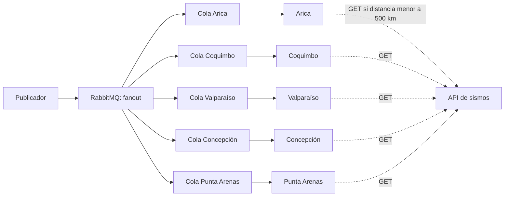

# Tarea 1 - INF326: notificación de sismos

Un publicador envía avisos a cinco ciudades mediante RabbitMQ. Cada ciudad calcula su distancia al epicentro y consulta el detalle en una API sólo si está a menos de 500 km.

## Integrantes

| Nombre completo | Rol |
| --- | --- |
| Erick Avila | 202273103-6 |
| Emilio Valdebenito | 202273040-4 |
| Hans Villouta | 202273052-8 |

## Ejecución

Se necesita Docker con Compose v2. En Windows, abrir Docker Desktop y esperar a que esté funcionando con contenedores Linux. Los puertos 8000, 5672 y 15672 deben estar libres. La primera ejecución necesita internet para descargar imágenes y dependencias.

Desde esta carpeta, iniciar los servicios una sola vez:

```sh
docker compose up --build -d
```

Esto inicia RabbitMQ, la API y los cinco suscriptores. El servicio `topology` crea las colas y termina; es normal que aparezca como finalizado. El publicador se ejecuta por separado.

### Publicar los sismos uno por uno

En la primera terminal, dejar los registros abiertos para ver los resultados nuevos en vivo:

```sh
docker compose logs -f --tail=0 arica coquimbo valparaiso concepcion punta_arenas
```

Abrir una segunda terminal en esta misma carpeta y publicar un sismo:

```sh
docker compose run --rm publisher python -m sismos.publisher --id demo-valparaiso
```

En la primera terminal aparecerán los resultados: Valparaíso, Coquimbo y Concepción muestran `detail` porque consultan el detalle. Arica y Punta Arenas muestran `ignored` porque están fuera de los 500 km. Si ocurre un error al procesar el aviso, se muestra `failed`.

Después de revisar el resultado, publicar otro desde la segunda terminal, por ejemplo:

```sh
docker compose run --rm publisher python -m sismos.publisher --id demo-arica
```

El publicador busca el ID indicado en `data/sismos.json`. Se puede cambiar el valor después de `--id` por cualquiera de los disponibles: `csn-385245`, `demo-arica`, `demo-coquimbo`, `demo-valparaiso`, `demo-concepcion`, `demo-punta-arenas` y `demo-lejano`.

Se pueden publicar en cualquier orden y repetirlos. Los suscriptores permanecen esperando entre publicaciones. Para dejar de ver los registros, presionar Ctrl+C en la primera terminal; los servicios siguen funcionando.

### Publicar todos los sismos

Para publicar los siete eventos del catálogo en una sola ejecución, usar una terminal disponible:

```sh
docker compose run --rm publisher
```

Este comando usa la opción `--all` configurada en `compose.yaml`. Los resultados aparecen en la terminal que sigue los registros. También se pueden consultar después con:

```sh
docker compose logs --tail=150 arica coquimbo valparaiso concepcion punta_arenas
```

### Consultar los servicios y detenerlos

- API y documentación interactiva: <http://localhost:8000/docs>.
- Detalle de un sismo: <http://localhost:8000/sismos/csn-385245>.
- Panel de RabbitMQ: <http://localhost:15672>, usuario `sismos` y contraseña `sismos_demo` (uso local).

Para detener los servicios:

```sh
docker compose down
```

Para borrar también las colas y los mensajes de prueba, usar `docker compose down --volumes`. Después se puede iniciar nuevamente con `docker compose up --build -d`.

## Arquitectura y archivos



La condición de distancia se aplica a las cinco ciudades. El exchange `fanout` copia cada aviso a una cola por ciudad. Los cinco suscriptores ejecutan el mismo código, cada uno con sus propias coordenadas. La API responde a `GET /sismos/{id}` con los datos completos; devuelve 404 si el ID no existe.

| Archivo | Qué hace |
| --- | --- |
| `sismos/publisher.py` | Lee el catálogo y publica los avisos. |
| `sismos/subscriber.py` | Recibe avisos, filtra por distancia y consulta la API. |
| `sismos/broker.py` | Conecta con RabbitMQ y crea el exchange y las colas. |
| `sismos/api.py` | Expone los datos mediante FastAPI. |
| `sismos/geo.py` y `sismos/config.py` | Calculan la distancia y definen las ciudades y conexiones. |
| `sismos/models.py` y `sismos/catalog.py` | Validan los datos y cargan el catálogo. |
| `data/sismos.json` | Contiene los sismos disponibles para la demostración. |
| `Dockerfile` y `compose.yaml` | Preparan el entorno y ejecutan los componentes. |
| `tests/test_system.py` | Comprueba el mensaje, la API y el comportamiento de los suscriptores. |

## Mensajes y consideraciones

El aviso contiene tres campos:

```json
{"id":"csn-385245","latitude":-33.28,"longitude":-72.1}
```

Las coordenadas permiten decidir si el sismo interesa antes de consultar la API. El ID permite pedir su detalle. La fecha, magnitud, profundidad y referencia geográfica se obtienen por HTTP, porque no se necesitan para filtrar. Enviar sólo el ID obligaría a consultar incluso por sismos lejanos; enviar el detalle completo haría innecesaria esa consulta.

El catálogo se carga en memoria al iniciar la API. Incluye el [sismo 385245 del CSN](https://sismologia.cl/sismicidad/informes/2026/10/385245.html) y seis casos simulados, identificados con `simulated: true`. No se incorporan sismos nuevos durante la ejecución. Las fechas usan UTC, las coordenadas grados y las distancias kilómetros.

La distancia se calcula con GeographicLib sobre WGS84. Se compara sin redondear y se exige estrictamente menos de 500 km. La profundidad forma parte del detalle y no interviene en ese filtro.

Las colas son durables y los avisos persistentes. Cada ciudad confirma el mensaje después de procesarlo. Si el aviso es inválido o falla la consulta HTTP, se registra el error y se descarta esa copia, sin reintentar. Un aviso publicado otra vez vuelve a procesarse. Hay una sola API y un solo RabbitMQ; no se implementan réplicas.

Los beneficios y costos de estas decisiones se explican en [DISCUSION.md](DISCUSION.md).

## Pruebas

Para ejecutar las pruebas automatizadas:

```sh
docker compose --profile test run --rm --build tests
```

Comprueban los campos del aviso, las respuestas de la API, el filtro de las cinco ciudades, el límite de 500 km y el manejo de errores. Simulan la conexión a RabbitMQ; los comandos de ejecución anteriores permiten probar el recorrido completo con el broker real.
